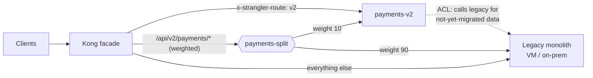

# Strangler-fig facade (Kong DB-less)

Reference manifests for incrementally replacing a legacy monolith: a **Kong** facade (same DB-less Kong
3.x setup as `deploy/helm/kong-gateway`) intercepts all traffic, sends `/api/v2/payments/*` to the new
`payments-v2` service and everything else to the legacy monolith. Background and decision guidance:
[docs/modernization/strangler-fig.md](../../../docs/modernization/strangler-fig.md).

| File | What |
|---|---|
| `namespace.yaml` | `strangler` namespace (Pod Security `restricted`) |
| `legacy-backend.yaml` | The monolith inside the cluster: selector-less `Service` + `EndpointSlice` (on-prem / preserved VM IPs), `ExternalName` alternative, and a `Service` selecting a VM rehosted by MTV (`vm.kubevirt.io/name`) |
| `payments-v2.yaml` | New service `Deployment` + `Service` + `NetworkPolicy` (only the facade may call it) |
| `kong-config.yaml` | Kong declarative config in a `ConfigMap`: routes, weighted upstream, header canary, correlation id, Prometheus |
| `kong-facade.yaml` | Kong `Deployment`, `Service`, `Ingress` for the public hostname |
| `mesh-shadow.yaml` | Optional Istio `VirtualService` that mirrors payments traffic to v2 (shadow stage) |
| `kustomization.yaml` | `kubectl apply -k deploy/k8s/strangler` (shadow file excluded by default) |



## Routing rules

| Request | Backend |
|---|---|
| `/api/v2/payments/*` with `x-strangler-route: v2` | `payments-v2` (testers, synthetic checks) |
| `/api/v2/payments/*` with `x-strangler-route: legacy` | legacy (pin a client back) |
| `/api/v2/payments/*` | `payments-split` upstream: weighted v2 / legacy |
| anything else | legacy monolith |

Header routes outrank path-only routes in Kong's router, so the header pins always win. The regex path
`~/api/v2/payments(/|$)` matches `/api/v2/payments` and its sub-paths but not `/api/v2/payments-old`.

## Walkthrough

### Stage 0 — prerequisites

- The legacy app is reachable from the cluster: update the `EndpointSlice` addresses (on-prem VIP or
  the IPs the VM kept on a Multus VLAN after MTV), or use `legacy-monolith-dns` / `legacy-monolith-vm`.
- `payments-v2` passes its own tests against a copy of production data; data sync is in place
  (CDC from the legacy DB, see [database-migration.md](../../../docs/modernization/database-migration.md)).

### Stage 1 — intercept

Put the facade in the path **without changing behaviour**: set the `payments-split` weights to
`payments-v2: 0` / legacy `100` (or remove the v2 target), apply, then move the public DNS name
(`app.example.com`) to the facade's ingress.

```bash
kubectl apply -k deploy/k8s/strangler
kubectl -n strangler rollout status deploy/strangler-facade
curl -sI https://app.example.com/ | grep -i x-correlation-id     # served by legacy through Kong
```

Exit: error rate and latency through the facade equal the direct path for 24–72 h.

### Stage 2 — route (header canary, optional shadow)

The route to v2 exists but only opted-in callers use it:

```bash
curl -H 'x-strangler-route: v2' https://app.example.com/api/v2/payments/health
```

Optional shadow: install Istio, set `PAYMENTS_SHADOW_MODE=true` on `payments-v2`, apply
`mesh-shadow.yaml`, and compare legacy vs v2 responses by `X-Correlation-ID`. Mirroring a
payments endpoint is only safe while v2 suppresses side effects.

### Stage 3 — migrate the slice (weighted)

Raise the v2 weight in `kong-config.yaml` (5 → 25 → 50 → 100), commit, and restart the facade
(DB-less Kong reads the file at start):

```bash
kubectl -n strangler rollout restart deploy/strangler-facade
```

Watch per-backend error rate and latency (`kong_http_requests_total`, `kong_upstream_target_health`).
Roll back by lowering the weight or sending `x-strangler-route: legacy`. When v2 is at 100 %, remove the
legacy target from `payments-split` and make v2 the system of record for payments data (stop CDC
legacy → v2, start reverse sync if other legacy modules still read payments tables).

### Stage 4 — retire legacy

Repeat stages 2–3 per slice. When the catch-all route serves no meaningful traffic (Kong metrics on
`legacy-catch-all`), retire the monolith: freeze it read-only, archive data, delete the legacy
`Service`/`EndpointSlice` and the catch-all route, and decommission the VM
([cutover runbook](../../../ops/runbooks/migration/cutover.md) decommission steps).

## Validation

These are plain built-in objects (plus the Istio `VirtualService`, skipped without a schema) and are
validated with `kubeconform -strict` (Kubernetes 1.30) by `scripts/ci/validate-infra.sh`.
