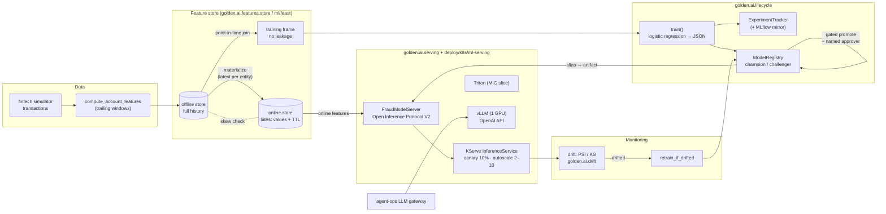

# ML Platform — features to serving to monitoring

How a model gets from raw events to a governed, monitored prediction on this platform. Every stage
below has running code and tests; the Kubernetes manifests show the production shape of the same
stage. The running example is the fintech **fraud model**.



## 1. Features

Code: [`src/golden/ai/features/store.py`](../../src/golden/ai/features/store.py) ·
Feast equivalent: [`ml/feast/`](../../ml/feast/README.md) · tests: `tests/test_ml_platform.py`.

| Concept | What it means | In the code |
|---|---|---|
| Entity | The thing features describe, with a join key | `ACCOUNT = Entity("account", "account_id")` |
| Feature view | Named features for one entity + TTL + source | `ACCOUNT_TXN_VIEW`: `txn_count_1h`, `amount_sum_24h`, `distinct_countries_24h`, TTL 1 h |
| Offline store | Every feature row ever computed, with its timestamp | `OfflineStore` (pandas); Feast: file/BigQuery/Snowflake |
| Online store | Latest value per entity for low-latency lookup | `OnlineStore` (dict); Feast: SQLite/Redis/DynamoDB |
| Materialization | Copy latest rows in a window offline → online | `materialize`, `materialize_incremental` |

**Feature computation.** `compute_account_features` emits one row per transaction holding the
account's aggregates over the trailing, right-closed windows `(t − 1h, t]` and `(t − 24h, t]`. The
row at `t` includes the transaction at `t` and nothing after it.

**Point-in-time correctness.** A training example labelled at time `T` may only see feature values
that were known at `T`. `get_historical_features` does an as-of join (`pandas.merge_asof`,
`direction="backward"`, per entity): for each `(account_id, T)` take the latest feature row with
`feature_ts ≤ T`. A naive "join on account_id, take the latest row" leaks the future — the model
trains on velocity counts that include transactions that had not happened yet, scores brilliantly
offline and disappoints in production. `test_no_leakage_against_brute_force_on_simulator` checks
the join against a brute-force scan on simulator data.

**TTL.** The join's tolerance is the view's TTL: a row older than `T − ttl` yields nulls instead of a
stale value (a `txn_count_1h` from three hours ago is not "the count in the last hour"). Online,
`get_online_features` returns `EXPIRED` with null values for the same condition, and `NOT_FOUND`
for unknown keys, so the caller can apply an explicit default rather than silently using old data.

**Training–serving skew.** `check_skew(view, as_of=T)` samples entity keys and compares what the
online store would serve at `T` with what the offline point-in-time join returns at `T`. Any
difference means the two paths disagree: missed materialization, a different code path writing
online values, a type change. Run it after every materialization job and alert on
`mismatch_rate > 0`.

## 2. Training

Code: [`src/golden/ai/lifecycle/fraud_model.py`](../../src/golden/ai/lifecycle/fraud_model.py).
Class-weighted logistic regression in numpy, stratified 80/20 split, F2-calibrated threshold
(recall weighted over precision). The model is **serialized as JSON** (weights, normalization,
threshold, feature list), not pickle, so an artifact can be reviewed and diffed, and loading it does
not execute code. The feature list is checked on load: an artifact trained on a different feature
set refuses to load.

## 3. Tracking and registry

* `ExperimentTracker` ([`tracking.py`](../../src/golden/ai/lifecycle/tracking.py)) records params,
  metrics and artifacts per run (optionally mirrored to MLflow with the `[mlops]` extra).
* `ModelRegistry` ([`registry.py`](../../src/golden/ai/lifecycle/registry.py)) stores immutable
  versions and moving **aliases** (`champion`, `challenger`, `staging`). Promotion to `champion`
  requires every metric gate, no regression beyond tolerance on the primary metric, and a **named
  human approver**; rollback moves the alias back. Every step is written to the audit log.
* CLI: `golden model drift|retrain|promote|rollback|list`.

## 4. Serving

Code: [`src/golden/ai/serving/`](../../src/golden/ai/serving) · manifests:
[`deploy/k8s/ml-serving/`](../../deploy/k8s/ml-serving/README.md).

**Open Inference Protocol (V2).** The request/response contract shared by KServe, Triton, Seldon
MLServer and TorchServe ([`protocol.py`](../../src/golden/ai/serving/protocol.py)):

```json
POST /v2/models/fraud-detector/infer
{"id": "r1", "inputs": [{"name": "features", "shape": [1, 7], "datatype": "FP32",
                         "data": [6.2, 0, 1, 0, 0, 0, 1]}]}

200  x-model-version: 3
{"model_name": "fraud-detector", "model_version": "3", "id": "r1",
 "outputs": [{"name": "probability", "shape": [1], "datatype": "FP64", "data": [0.91]},
             {"name": "is_fraud", "shape": [1], "datatype": "BOOL", "data": [true]}],
 "parameters": {"threshold": 0.42}}
```

**`FraudModelServer`** ([`server.py`](../../src/golden/ai/serving/server.py)) is what the KServe
custom predictor runs:

| Concern | Behaviour |
|---|---|
| Model source | `fraud-detector@champion` resolved through `ModelRegistry`; JSON artifact |
| Readiness | not ready (503) until a model is loaded — the pod stays out of the Service |
| Champion swap | `reload()` / `POST /v2/models/{name}/reload` re-resolves the alias and swaps atomically |
| Validation | shape `[N, 7]` or one `[N]` tensor per feature; datatypes; finite values; one-hot ∈ {0, 1}; 400 on violation |
| Batching | `max_batch_size` (413 above it); `infer_batch` runs several requests as one forward pass |
| Attribution | `model_version` in every response and `x-model-version` header |

The HTTP app is `golden.ai.serving.app:app` (FastAPI via the platform's `create_app`, so auth, rate
limiting, request IDs and `/metrics` come for free).

**Deployment options** ([`deploy/k8s/ml-serving/`](../../deploy/k8s/ml-serving/README.md)):

| Server | Use it for | Manifest |
|---|---|---|
| KServe custom predictor | Platform models in the platform image; canary and autoscaling from KServe | `inferenceservice.yaml` |
| NVIDIA Triton | ONNX / TensorRT / PyTorch models needing GPU dynamic batching | `triton.yaml` (+ `triton-model-repository/`) |
| vLLM | Open-weight LLMs behind an OpenAI-compatible API (PagedAttention, continuous batching) | `vllm.yaml` |

**Canary.** Two layers that compose: KServe `canaryTrafficPercent: 10` splits traffic between the
previous and the new predictor revision at the ingress; in-process,
[`ModelRouter`](../../src/golden/ai/lifecycle/rollout.py) does sticky hash-based canary
(5 → 20 → 50 → 100 %), shadow and blue/green between champion and challenger, with automatic
rollback when the challenger's error rate or p95 latency regresses.

**Autoscaling.** Knative KPA on concurrency (`scaleMetric: concurrency`, `scaleTarget: 20`),
`minReplicas: 2` so the payment path never cold-starts. GPU servers (vLLM, Triton) scale on queue
depth / GPU metrics with KEDA or HPA custom metrics rather than CPU.

**Network.** `networkpolicy.yaml` denies all ingress to `golden-ml`, then allows vLLM only from the
agent-ops LLM gateway, Triton only from the API gateway, the KServe predictor only from the
Istio/Knative gateways, and metrics only from Prometheus.

## 5. Monitoring and retraining

* **Data drift**: [`golden.ai.drift`](../../src/golden/ai/drift.py) — PSI (numeric and categorical)
  and two-sample KS between the training reference and live traffic.
* **Retraining**: `retrain_if_drifted` ([`retrain.py`](../../src/golden/ai/lifecycle/retrain.py))
  retrains when drift crosses the threshold and registers the result as `challenger` only if it
  passes the quality gate (the very first model bootstraps the `champion` slot). It never promotes
  over an existing champion; promotion stays a gated, human-approved step.
* **Skew**: `FeatureStore.check_skew` after each materialization.
* **Serving**: `golden_model_requests_total{model,version,role}` and shadow disagreement counters
  from `ModelRouter`; HTTP latency histograms from `create_app`; GPU utilisation per device / MIG
  instance from the DCGM exporter ([GPU partitioning](../verticals/gpu-partitioning.md)).

## File map

| Path | Stage |
|---|---|
| `src/golden/ai/datasets/fintech_simulator.py` | Synthetic transactions |
| `src/golden/ai/features/store.py` | Feature views, offline/online stores, point-in-time join, skew |
| `ml/feast/` | Feast repo for the same features |
| `src/golden/ai/lifecycle/fraud_model.py` | Training, JSON model artifact |
| `src/golden/ai/lifecycle/tracking.py` | Experiment tracking |
| `src/golden/ai/lifecycle/registry.py` | Versions, aliases, gated promotion, rollback |
| `src/golden/ai/lifecycle/rollout.py` | Shadow / canary / blue-green routing |
| `src/golden/ai/lifecycle/retrain.py` | Drift-triggered retraining |
| `src/golden/ai/drift.py` | PSI / KS drift |
| `src/golden/ai/serving/protocol.py` | Open Inference Protocol V2 types + validation |
| `src/golden/ai/serving/server.py` | Champion model server, batching, hot swap |
| `src/golden/ai/serving/app.py` | HTTP endpoints (`/v2/...`) |
| `deploy/k8s/ml-serving/` | KServe, vLLM, Triton, NetworkPolicies |
| `deploy/k8s/gpu-operator/` | GPU Operator, MIG, time-slicing, DCGM |
| `src/golden/gpu/partitioning.py` | MIG packing, sharing-strategy advice, GPU cost savings |
| `tests/test_ml_platform.py` | Point-in-time, TTL, skew, serving, MIG packing tests |
