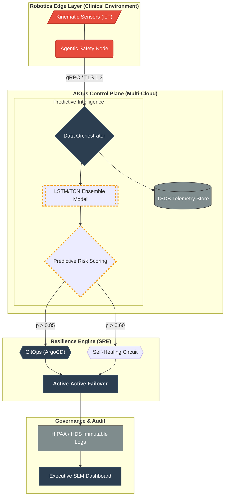

# Data Flow Architecture: Predictive Healthcare AIOps

## Executive Summary

This architecture integrates **Agentic Clinical Safety** with a **High-Availability AIOps Plane**. By utilizing dual-model inference (LSTM/TCN), the platform predicts kinematic anomalies in robotics telemetry before they result in clinical failure, triggering automated GitOps-driven failover.

## System Architecture Diagram

## Technical Breakdown

| Component | Technology Stack | Responsibility |
| --- | --- | --- |
| **Edge Layer** | [Robotics Module](https://github.com/Here2ServeU/Naweji-Reliability-Platform/tree/main/robotics) | Real-time kinematic telemetry ingestion and local safety mediation. |
| **Predictive Engine** | [AI Brain (LSTM/TCN)](https://github.com/Here2ServeU/Naweji-Reliability-Platform/tree/main/ai) | Time-series forecasting to identify "pre-failure" signatures in sensor data. |
| **Resilience Engine** | [SRE / GitOps](https://github.com/Here2ServeU/Naweji-Reliability-Platform/tree/main/gitops) | Automated re-provisioning and failover via [ArgoCD](https://github.com/Here2ServeU/Naweji-Reliability-Platform/tree/main/gitops) based on risk scores. |
| **Audit Plane** | [Compliance Docs](https://www.google.com/search?q=https://github.com/Here2ServeU/Naweji-Reliability-Platform/tree/main/docs/compliance) | Ensures every automated action is logged for HIPAA and HDS regulatory standards. |

---

### Pro-Tip for your Portfolio:

Notice that I added **Probability Thresholds** (e.g., `p > 0.85`) to the diagram lines. This subtle detail demonstrates to hiring managers that you understand **Decision Science** and how to tune AI for operational reliability.
