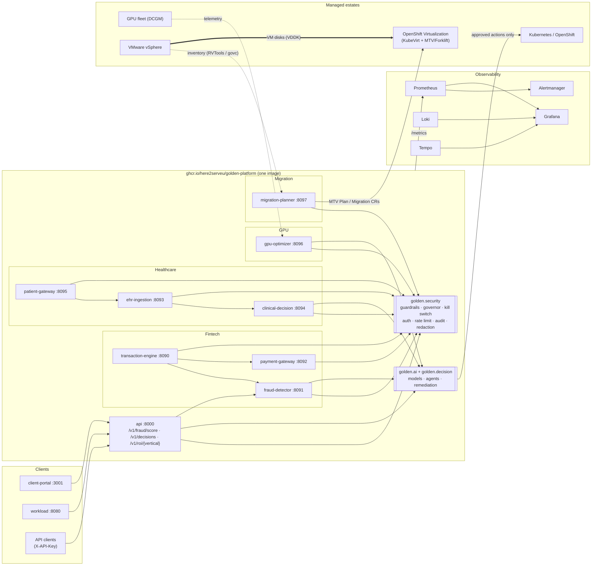

# Architecture Overview — Golden Path Monorepo

The Golden Platform is a single, opinionated **golden-path monorepo**: one Python
package, one container image, one CLI, one observability contract — and four
business domains built on the same AI, decision, security and delivery
foundations. It doubles as an **end-to-end template for enterprise-scale
modernization engagements** (see [docs/modernization](../modernization/README.md)).

## Business domains

| Domain | What it does | Services (port) | Docs |
|---|---|---|---|
| **Healthcare** | EHR ingestion, PHI-risk scoring, clinical decision support | ehr-ingestion (8093), clinical-decision (8094), patient-gateway (8095) | [verticals/healthcare.md](../verticals/healthcare.md) |
| **Fintech** | Transaction processing, real-time fraud scoring, payment resilience | transaction-engine (8090), fraud-detector (8091), payment-gateway (8092) | [verticals/fintech.md](../verticals/fintech.md) |
| **GPU / AI infrastructure** | GPU fleet telemetry, thermal/ECC/memory anomalies, rightsizing, consolidation, power capping, savings | gpu-optimizer (8096) | [verticals/gpu.md](../verticals/gpu.md) |
| **Modernization / migration** | VMware vSphere → OpenShift Virtualization assessment, wave planning, MTV manifest generation, cutover tracking | migration-planner (8097) | [modernization/README.md](../modernization/README.md), [vmware-to-openshift.md](../modernization/vmware-to-openshift.md) |

Shared: the **platform API** (`api`, 8000) fronts fraud scoring, decisions and ROI;
Node apps under `apps/` provide the client portal (3001) and the workload dashboard (8080).

## Repository layout

```text
.
├── src/golden/                 # the single Python package  (pip install -e .[dev]; CLI: golden)
│   ├── ai/                     # agents, anomaly_detection, business_value, classification, datasets,
│   │                           # evaluation, explainability, features, inference, models, pipelines,
│   │                           # prediction, remediation, training, worker, accel (GPU acceleration)
│   ├── decision/               # risk rules + decision engine
│   ├── security/               # AI safety: guardrails, action governor, kill switch, integrity,
│   │                           # API-key auth, rate limiting, hash-chained audit log, PHI redaction
│   ├── gpu/                    # GPU fleet optimization domain logic
│   ├── migration/              # VMware → OpenShift assessment, wave planning, MTV manifests
│   ├── services/{fintech,healthcare,gpu,migration}/   # FastAPI services (golden serve <service>)
│   ├── api/                    # platform API (golden serve api)
│   ├── observability/          # metrics, logging, tracing helpers
│   ├── robotics/               # surgical-robotics gRPC demo
│   └── demo/                   # client & engine demos (golden demo ...)
├── apps/{client-portal,workload}/   # Node.js apps
├── deploy/{helm,k8s,openshift,terraform,gitops}/
│   └── openshift/virtualization/{operators,migration,waves}/   # OpenShift Virtualization + MTV
├── observability/              # Prometheus, Alertmanager, Grafana, Loki, Tempo
├── security/                   # policies, threat models, IAM/RBAC, scanning
├── ops/{runbooks,sre}/         # operational runbooks, SRE practices, chaos
├── tools/{http,k6,kafka}/      # API collections, load tests, Kafka tooling
├── scripts/                    # init-project.sh (template rebrand); legacy/ (pre-monorepo scripts)
├── datasets/  proto/  tests/  docs/
```

## CLI

```bash
pip install -e .[dev]               # add [ml] for torch (see guides/gpu-acceleration.md)
golden serve <service>              # api | transaction-engine | fraud-detector | payment-gateway |
                                    # ehr-ingestion | clinical-decision | patient-gateway |
                                    # gpu-optimizer | migration-planner
golden demo client --vertical hospital|bank|gpu --client "Acme" [--fast]
golden demo engine --epochs 1
golden roi --vertical healthcare|fintech|gpu --tier professional
golden train --model lstm|tcn --epochs 3
golden orchestrate --cycles 3
golden security status
golden migrate assess|plan|manifests
```

## Runtime topology



## Cross-cutting contracts

- **Health & metrics** — every service exposes `/health`, `/ready` and `/metrics`
  (Prometheus text). HTTP RED metrics: `golden_http_requests_total{service,method,path,status}`,
  `golden_http_request_duration_seconds`. Domain metrics are listed in
  [observability/README.md](../../observability/README.md).
- **AI safety** — every model input passes guardrails; every autonomous action passes the
  action governor (default `GOLDEN_AUTONOMY_MODE=dry_run`). See
  [security/ai-safety.md](../security/ai-safety.md).
- **Auth** — when `GOLDEN_API_KEYS` is set, every non-health route requires `X-API-Key`.
- **GPU acceleration** — training and inference auto-select CUDA → MPS → CPU with AMP. See
  [guides/gpu-acceleration.md](../guides/gpu-acceleration.md).
- **Delivery** — one image, Helm charts and Kustomize/Argo CD GitOps under `deploy/`;
  OpenShift Virtualization and MTV assets under `deploy/openshift/virtualization/`.

## Compose DNS names

In `docker compose` the service DNS names equal the service names: `api`, `transaction-engine`,
`fraud-detector`, `payment-gateway`, `ehr-ingestion`, `clinical-decision`, `patient-gateway`,
`gpu-optimizer`, `migration-planner`, `client-portal`, `workload`.
Prometheus scrapes them with one job per domain: `platform-api`, `fintech`, `healthcare`,
`gpu`, `migration`, `apps` (+ optional `dcgm-exporter:9400`).

## Related

- [Platform overview (narrative)](./platform-overview.md)
- [High-level architecture](./01-high-level-architecture.md)
- [Legacy structure migration notes](./structure-migration-legacy.md)
