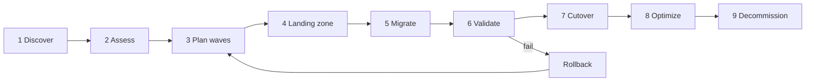

# Enterprise Modernization Playbook

This repository is a **complete, end-to-end template for enterprise-scale modernization
engagements** — from the first inventory export to decommissioning the last legacy host. It ships
the landing zone (OpenShift, GitOps, observability, security), the AI-assisted assessment and
wave planner (`golden migrate`, service `migration-planner` on port 8097), the migration assets
(OpenShift Virtualization + Migration Toolkit for Virtualization), and the runbooks to operate it.

The flagship path is **VMware vSphere → Red Hat OpenShift Virtualization** (KubeVirt + MTV/Forklift);
the detailed runbook is [vmware-to-openshift.md](./vmware-to-openshift.md). The same phases apply to
replatforming VMs to containers and refactoring to cloud-native services.

Identity is modernized alongside the estate. [aws-iam-modernization.md](./aws-iam-modernization.md)
covers moving from per-account IAM users and SAML roles to persona-based IAM Identity Center access
(AD groups via PingFederate SCIM). It also covers SCP/RCP guardrails, a mandatory permission boundary,
an OPA plan gate and Wiz-driven gap assessment (`golden iam`, service `identity-governance` on port 8098).

## Lifecycle



| # | Phase | What happens | Platform support | Exit criteria (gate) |
|---|---|---|---|---|
| 1 | **Discover** | Export inventory (RVTools vInfo/vDisk/vNetwork CSV or `govc`), CMDB, app owners, dependencies (flows, DNS, firewall rules) | `golden migrate assess --inventory <rvtools-csv-dir\|vInfo.csv\|vms.json>` ingests inventory | ≥ 95 % of VMs mapped to an application & owner; dependency data for all tier-1 apps |
| 2 | **Assess** | Classify every VM: rehost / replatform / refactor / retire / retain; flag blockers | Rule engine (RDM, shared disks, vGPU, encryption, OS support…) + complexity score; `POST /api/v1/migration/assess` | Every VM has a disposition and blocker list; business sign-off on retire/retain |
| 3 | **Plan waves** | Group by application & dependency, order by criticality and size, choose cold vs warm | `golden migrate plan`; `POST /api/v1/migration/plan` | Wave calendar approved by CAB; each wave has owners, window, rollback plan |
| 4 | **Landing zone** | OpenShift 4.14+, OpenShift Virtualization & MTV operators, storage (ODF/RWX), Multus networks, GitOps, observability, security baselines | `deploy/openshift/virtualization/operators`, `deploy/gitops`, `observability/`, `security/` | Pilot VM migrated & validated; DR/backup tested; security review passed |
| 5 | **Migrate** | **Rehost** VMs with MTV (cold or warm); **replatform** to containers (`deploy/helm`); **refactor** into services | `golden migrate manifests` → MTV `Provider`/`NetworkMap`/`StorageMap`/`Plan`/`Migration` CRs in `deploy/openshift/virtualization/{migration,waves}` | All VMs in the wave `Succeeded`; failure ratio < 5 % |
| 6 | **Validate** | Smoke tests, app owner UAT, performance vs baseline, monitoring & backups in place | Golden dashboards, SLOs, synthetic tests (`ops/sre/observability`) | UAT sign-off; SLOs met for 24–72 h |
| 7 | **Cutover** | DNS/LB switch, final warm-migration delta, source VMs powered off (not deleted) | [ops/runbooks/migration/cutover.md](../../ops/runbooks/migration/cutover.md) | Go/no-go passed; traffic on target; hypercare started |
| 8 | **Optimize** | Rightsize CPU/memory, storage tiering, autoscaling, containerize next candidates | Platform AI recommendations, GPU domain for AI workloads | Utilization targets met; FinOps report delivered |
| 9 | **Decommission** | Remove source VMs, reclaim licences (vSphere, OS, backup), update CMDB | Decommission checklist in the runbook | Source deleted after retention window; licences returned; CMDB closed |

Rollback at any point before decommission: [ops/runbooks/migration/rollback.md](../../ops/runbooks/migration/rollback.md).

## Migration strategies

| Strategy | When | Tooling in this repo |
|---|---|---|
| **Rehost** (lift & shift VM) | Supported guest OS, no blockers, low change appetite | MTV cold/warm migration to OpenShift Virtualization |
| **Replatform** (VM → container) | Stateless app tiers, standard runtimes (Java, .NET Core, Node, Python) | Helm charts / Kustomize under `deploy/`, GitOps via Argo CD |
| **Refactor** | Strategic apps needing scale, resilience or AI features | Service templates in `src/golden/services/*`, platform API, observability contract |
| **Retire / Retain** | No owner, no traffic, or regulatory hold | Captured in the assessment; excluded from waves |

## Roles (RACI-lite)

| Activity | Engagement lead | Platform / SRE | Migration engineer | App owner | Security | CAB / Sponsor |
|---|---|---|---|---|---|---|
| Discovery & inventory | A | C | R | C | I | I |
| Assessment & dispositions | A | C | R | C | C | I |
| Wave plan & calendar | R | C | R | C | I | A |
| Landing zone build | A | R | C | I | C | I |
| Security baseline & approvals | I | C | I | I | R/A | I |
| Wave execution (MTV) | I | C | R/A | I | I | I |
| Validation / UAT | I | C | C | R/A | C | I |
| Cutover go / no-go | R | C | C | C | C | A |
| Rollback decision | C | C | R | C | I | A |
| Decommission | A | R | R | C | C | I |

R = responsible, A = accountable, C = consulted, I = informed.

## Observability & SLOs

- Prometheus job `migration` (`migration-planner:8097`), rules in
  `observability/prometheus/rules/migration_rules.yml`, dashboard
  **Golden Platform — VM Migration** (`observability/grafana/dashboards/golden-migration.json`).
- Metrics: `golden_migration_vms_total{status}`, `golden_migration_wave_progress_ratio{wave}`,
  `golden_migration_failures_total{reason}`, `golden_migration_duration_seconds`.
- Engagement SLOs: per-wave success ≥ 95 % first attempt; cutover within the approved window;
  zero data loss; post-cutover application SLOs equal to or better than baseline.
- Migration actions (`start_vm_migration`, `vm_cutover`, `vm_rollback`) are **critical** in the
  action governor and always need a named human approver — see [AI safety](../security/ai-safety.md).

## Using this repo as a template for a new engagement

1. **Fork / copy** the repository for the client.
2. **Rebrand** it:

   ```bash
   scripts/init-project.sh <slug>      # e.g. acme-modernization
   ```

   This renames the package/CLI, image names, Helm release names and dashboard titles to the slug.
3. **Fill `config/`** with the engagement specifics: clusters and namespaces, vCenter endpoint and
   credentials *references* (never secrets), storage classes, network mappings (port group → NAD),
   wave windows, owners and notification channels.
4. **Stand up the landing zone**: apply `deploy/openshift/virtualization/operators` and the GitOps
   apps; start the observability stack; set `GOLDEN_API_KEYS` and `GOLDEN_AUTONOMY_MODE=supervised`.
5. **Discover & assess**: `golden migrate assess --inventory <export>` and review blockers with app owners.
6. **Plan**: `golden migrate plan` → review the wave calendar → CAB approval.
7. **Generate manifests**: `golden migrate manifests` → commit to
   `deploy/openshift/virtualization/waves/` → Argo CD syncs them.
8. **Execute** each wave with the [cutover runbook](../../ops/runbooks/migration/cutover.md).
9. **Report**: `golden roi`, dashboards and the audit log form the client-facing evidence pack.

## Related

- [VMware → OpenShift runbook](./vmware-to-openshift.md)
- [AWS IAM modernization](./aws-iam-modernization.md)
- [Portfolio rationalization (7 Rs, TIME)](./portfolio-7rs.md)
- [Database migration (SCT, DMS, CDC, cutover)](./database-migration.md)
- [Strangler fig pattern](./strangler-fig.md)
- [Database cutover runbook](../../ops/runbooks/migration/database-cutover.md)
- [Architecture overview](../architecture/overview.md)
- [Consulting playbook](../consulting/consulting_playbook.md)
