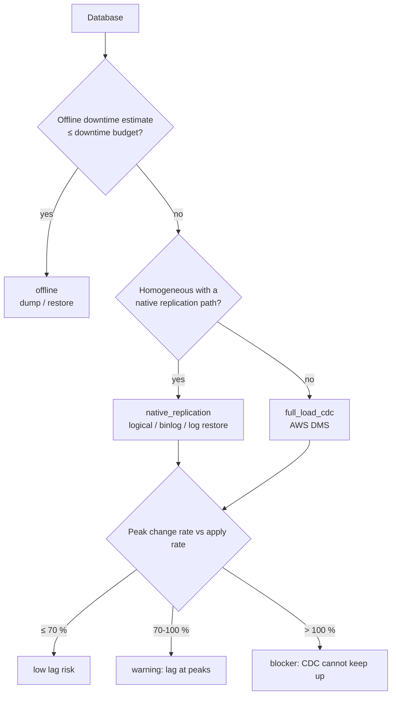

# Database Migration

How databases move when their applications are replatformed or refactored: target choice, schema
conversion, data movement (offline, DMS full load + CDC, native replication), validation, cutover and
rollback. The assessment is `golden.migration.database`. The AWS DMS infrastructure is
`deploy/terraform/modules/aws/dms`. The operational procedure is
[ops/runbooks/migration/database-cutover.md](../../ops/runbooks/migration/database-cutover.md).

Rehosted VMs take their databases with them (MTV copies the disks), and nothing on this page applies to
them until a later wave moves the database to a managed service. Which apps are replatformed or
refactored comes from [portfolio-7rs.md](./portfolio-7rs.md).

## Homogeneous vs heterogeneous

| | Homogeneous (same engine) | Heterogeneous (engine change) |
|---|---|---|
| Examples | Oracle → RDS for Oracle; SQL Server → RDS for SQL Server; MySQL → Aurora MySQL; PostgreSQL → Aurora PostgreSQL / Crunchy Postgres on OpenShift | Oracle → Aurora PostgreSQL; SQL Server → Aurora PostgreSQL (Babelfish); Db2 → Aurora PostgreSQL |
| Schema | Native DDL export / restore | Converted with **AWS SCT** and action items fixed by hand |
| Code (procedures, packages, triggers) | Unchanged | Rewritten (PL/SQL or T-SQL → PL/pgSQL), then unit-tested |
| Data movement | Native tools or native replication; DMS also works | DMS (full load + CDC) or dump → transform → load |
| Main risk | Version / feature differences on the managed service | Conversion effort, behaviour differences, performance |
| Licence impact | BYOL or licence-included | Commercial engine licences removed |

### Target rules (`recommend_target`)

| Source | Recommendation | When |
|---|---|---|
| Oracle | **RDS for Oracle (BYOL)** | > 100 PL/SQL packages, RAC, or Enterprise Edition with partitioning (or `prefer="homogeneous"`) |
| Oracle | **Aurora PostgreSQL** | otherwise (modest PL/SQL) |
| SQL Server | **RDS for SQL Server** | CLR assemblies, linked servers or > 200 stored procedures |
| SQL Server | **Aurora PostgreSQL** + Babelfish | otherwise; run Babelfish Compass first to check T-SQL coverage |
| MySQL / MariaDB | **Aurora MySQL** | always |
| PostgreSQL | **Aurora PostgreSQL**, or **Crunchy Postgres for Kubernetes** with `platform="openshift"` | always |
| Db2 | **Aurora PostgreSQL** (heterogeneous) | always; retaining Db2 is a portfolio decision |

## Compatibility findings

Findings use the same `Finding(code, severity, message, remediation)` shape as the VM assessment.

| Code | Severity | Trigger | Remediation (summary) |
|---|---|---|---|
| `PLSQL_PACKAGES` | warning, blocker if > 100 | heterogeneous Oracle with packages | SCT report; package state and autonomous transactions need redesign |
| `STORED_PROCEDURES` | info, warning if > 50 | heterogeneous with procedures | SCT action items; unit-test converted code |
| `TRIGGERS` | info | heterogeneous with triggers | convert; disable on target during full load |
| `LINKED_SERVERS` | warning | linked servers / DB links | replace with APIs or `postgres_fdw`, or check managed-service support |
| `CLR` | blocker off SQL Server, warning on RDS | CLR assemblies | move logic to the app tier or keep SQL Server (verify RDS version support) |
| `RAC` | warning | Oracle RAC | Multi-AZ replaces RAC; test FAN/TAF failover in the app |
| `PARTITIONING` | info | heterogeneous with partitioning | PostgreSQL declarative partitioning; reference/interval partitions by hand |
| `LOBS` | warning | LOB columns | DMS limited-LOB mode with a measured max size; big-LOB tables in a separate task |
| `NO_PRIMARY_KEY` | warning | tables without PK | CDC needs a PK / unique key (or full supplemental logging) |
| `SOURCE_REPLICATION` | info | existing replication | check log retention / supplemental logging; capture from a standby where supported |
| `TDE` | info | source TDE | grant CDC access to encrypted logs; KMS on the target |
| `OLD_VERSION` | warning | below the assumed CDC minimum | upgrade first or go offline; verify against current DMS docs |
| `CDC_LAG` | warning (> 70 % of apply rate at peak) / blocker (> 100 %) | online strategies | parallel tasks, batch apply, bigger instance, reduce churn |
| `LONG_FULL_LOAD` | warning | full load > 72 h | more bandwidth, parallel load, or offline seed (Snowball / backup) + CDC |

### Schema conversion effort (AWS SCT)

For heterogeneous moves, the SCT assessment report lists the action items that need manual work. Before
that report exists, the assessment estimates the work by splitting each object type into simple / medium /
complex buckets:

| Object | simple / medium / complex | Hours per bucket |
|---|---|---|
| Stored procedures | 60 / 30 / 10 % | 0.5 / 2 / 8 |
| PL/SQL packages | 20 / 50 / 30 % | 0.5 / 2 / 8 |
| Triggers | 70 / 25 / 5 % | 0.5 / 2 / 8 |

These splits are heuristics (`SCT_MIX`, `SCT_HOURS`). Once you have the real SCT assessment report,
replace the estimate with its action-item counts.

## Choosing the data movement strategy



| Strategy | Tools | When it fits |
|---|---|---|
| **offline** | Data Pump (expdp/impdp), native `.bak` → S3 → `rds_restore_database`, `pg_dump -Fd -j` / `pg_restore -j`, mydumper/myloader | Small databases or generous windows |
| **native_replication** | PostgreSQL logical replication (also into Crunchy Postgres); MySQL/MariaDB binlog replication into Aurora MySQL; SQL Server native backup/restore with differential + log restores | Homogeneous moves with tight windows |
| **full_load_cdc** | AWS DMS full load + CDC (`deploy/terraform/modules/aws/dms`) | Heterogeneous moves, or homogeneous ones with no native path (e.g. on-prem Oracle → RDS for Oracle) |

Oracle GoldenGate is a valid alternative for Oracle sources when it is already licensed. The planner
does not pick it automatically.

### Timing math

```
full_load_hours          = size_gb × 8 / (bandwidth_gbps × 0.6 × 3600)
offline_downtime_minutes = full_load_hours × 60 × 2.0 + 30          # dump + transfer + restore + index build, + validation/switch
avg_change_gb_per_hour   = change_rate_gb_day / 24
peak_gb_per_hour         = avg × 3                                   # peak-hour factor
peak_utilization         = peak / apply_gb_per_hour                  # default apply rate 20 GB/h per task/stream
backlog_after_full_load  = avg × full_load_hours
catchup_hours            = backlog / (apply_gb_per_hour − avg)
```

Example: 1,000 GB over 1 Gbps takes 3.70 h of full load, so the offline estimate is about 474 min. With
a 120-minute budget that rules out offline. On PostgreSQL → Aurora PostgreSQL the planner picks logical
replication. At 10 Gbps the offline estimate is about 74 min, and dump/restore wins.

The 0.6 link efficiency, the 2× offline factor, the 3× peak factor and the 20 GB/h apply rate are
**planning defaults** (module constants). Replace them with numbers from a rehearsal: DMS task
statistics, `CDCLatencySource` / `CDCLatencyTarget`, and timed dump/restore runs.

### Running it

```python
from golden.migration.database import Database, assess_database, assess_databases, sample_databases

report = assess_databases(sample_databases(), bandwidth_gbps=1.0)        # summary + per-DB detail
one = assess_database(
    Database("claims-ora", "oracle", "19c", size_gb=900, change_rate_gb_day=60,
             plsql_packages=12, stored_procedures=60, lobs=True, max_downtime_minutes=60),
    bandwidth_gbps=1.0, platform="aws", prefer="auto",
)
```

Sample estate (`sample_databases()`, 1 Gbps): 2 offline, 3 DMS full load + CDC and 5 native
replication. `clickstream-mysql` (900 GB/day of change) is **blocked** on `CDC_LAG` until it is split
into parallel streams. Converting the three heterogeneous databases is estimated at about 625 h of SCT
action items.

## CDC prerequisites

| Source | Enable before the full load starts |
|---|---|
| Oracle | `ARCHIVELOG` mode, database-level minimal supplemental logging plus PK (or ALL) column logging on replicated tables, archive log retention ≥ full load + catch-up time |
| SQL Server | MS-CDC or MS-Replication on the tables (PK tables use replication, non-PK use MS-CDC), FULL recovery model, log backups that do not truncate unread changes |
| MySQL / MariaDB | `binlog_format=ROW`, `binlog_row_image=FULL`, binlog retention ≥ catch-up time |
| PostgreSQL | `wal_level=logical`, a replication slot, `max_replication_slots` / `max_wal_senders` headroom; watch slot lag (WAL piles up when the slot stalls) |

Check the exact settings against the current DMS source-endpoint documentation for your engine version.

## Validation

You need evidence that the target matches the source before cutover:

1. **Row counts** per table, source and target, taken after CDC has drained (writes paused, or a
   consistent snapshot / SCN / LSN).
2. **Checksums** on critical tables. Hash ordered rows (`md5(string_agg(...))` in PostgreSQL,
   `DBMS_CRYPTO` / `ORA_HASH` aggregates in Oracle, `HASHBYTES` / `CHECKSUM_AGG` in SQL Server).
   Compare per key range so a mismatch points at a slice.
3. **DMS data validation** (`EnableValidation: true` in the module defaults) runs row-level comparison
   during full load and CDC. Every table must end in `Validated`, never `Mismatched records`.
4. **Business checks**: totals that finance and ops recognise (e.g. sum of open invoices, payments per
   day), plus application smoke tests and a short performance comparison of the top queries.
5. **Sequences / identity** values reset on the target above the source maximum.

## Cutover and rollback

Every assessment returns a `cutover_plan` for its strategy. The generic online sequence:

1. Provision the target. For heterogeneous moves, also apply the converted schema (without FKs and triggers).
2. Start the full load + CDC, or native replication. Watch the lag alarms.
3. Validate while replication runs (counts, checksums, DMS validation).
4. **Cutover window**: stop application writes. Wait for lag ≈ 0. Stop replication. Enable FKs and
   triggers, and reset sequences. Switch connection strings or DNS. Re-enable writes.
5. Keep the **source read-only and intact** for the rollback window.

Rollback options, from cheapest to most expensive:

| Situation | Rollback |
|---|---|
| Before writes hit the target | Point the app back at the source; nothing to reconcile |
| Writes hit the target, rollback window planned | **Reverse replication** (DMS CDC task target → source, or a reverse publication) started at cutover keeps the source current; switch back |
| No reverse path | Replay target-side changes from application logs / audit tables, or accept the data loss window agreed with the business. Agree on this before go/no-go, not during the incident. |

Step-by-step: [database-cutover.md](../../ops/runbooks/migration/database-cutover.md).

## Infrastructure: DMS module

`deploy/terraform/modules/aws/dms` creates the following:

- the replication subnet group
- a provisioned instance + task, or DMS Serverless
- source and target endpoints, with credentials from Secrets Manager and `ssl_mode` set to require / verify-ca / verify-full
- KMS encryption
- CDC latency and storage alarms
- optionally the account-wide `dms-vpc-role` / `dms-cloudwatch-logs-role`

Every IAM role carries the permission boundary. The task is created stopped: starting it is a step in
the runbook.
