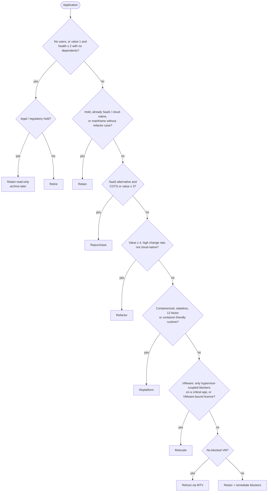

# Application Portfolio Rationalization (7 Rs and TIME)

Before any VM moves, every application in scope gets a **disposition**: what happens to it and where it
lands. This page describes the rule engine in `golden.migration.portfolio`, which turns a portfolio
inventory (CSV or Python objects) plus the VM assessment into explainable dispositions, effort and cost
estimates. Phases and roles are in the [modernization playbook](./README.md); the VM rehost path is in
[vmware-to-openshift.md](./vmware-to-openshift.md).

## The 7 Rs

| Disposition | Meaning | Typical target in this repo |
|---|---|---|
| **Retire** | Switch it off; archive data per retention policy | Decommission; archive to S3 Glacier / records system |
| **Retain** | Keep where it is for now (hold, recent investment, no viable route yet) | Current platform; revisit next planning cycle |
| **Rehost** | Lift and shift the VM unchanged | OpenShift Virtualization via MTV |
| **Relocate** | Move at the hypervisor level, no guest change | A VMware-compatible cloud (e.g. VMware Cloud Foundation hosted in a cloud region) |
| **Replatform** | Small changes to gain platform benefits (containers, managed DB) | OpenShift containers / EKS; managed database |
| **Repurchase** | Replace with a SaaS / different product | SaaS |
| **Refactor** | Re-architect for scale, resilience or speed of change | Cloud-native services on EKS / OpenShift, strangler fig ([strangler-fig.md](./strangler-fig.md)) |

## Decision tree

Rules are evaluated in order; the first that matches decides. Each result records the `rule` that fired
and `rationale` lines a reviewer can challenge.



| Rule | Disposition | Condition (exact) |
|---|---|---|
| R1 | Retire (Retain if `legal-hold` / `regulatory-hold`) | `users == 0`, or `business_value <= 1 and technical_health <= 2` and no other app depends on it |
| R2 | Retain | hold tag; `hosting == saas`; `hosting == cloud` and containerized + stateless + 12-factor; mainframe unless `business_value >= 4 and change_frequency == high` |
| R3 | Repurchase | `saas_alternative` and (`cots` or `business_value <= 3`) |
| R4 | Refactor | `business_value >= 4 and change_frequency == high` and not cloud-native (includes the mainframe refactor case) |
| R5 | Replatform | containerized, stateless or 12-factor, or `tech_stack` in node, python, go, java-springboot, java-tomcat, java-weblogic, java-websphere, java-jboss, dotnet-core, php, ruby |
| R6 | Relocate | `hosting == vmware` and either every blocker on the app's VMs is in {RDM_PHYSICAL, SHARED_DISK, INDEPENDENT_DISK, ENCRYPTED_VM} on a high / mission-critical app, or `licensing == vmware-bound` |
| R7 | Rehost | `hosting` in vmware / physical and no blocked VM |
| R8 | Retain | fallback — rehost blocked and no container or relocation route |

Notable consequences:

- **.NET Framework** apps are not container-friendly on Linux, so they reach R7 and are rehosted unless
  they are strategic and fast-changing (R4 → refactor to modern .NET).
- **WebLogic / WebSphere** apps replatform to JBoss EAP or Open Liberty containers (R5).
- **Mainframe** workloads are retained and API-enabled unless there is a strong refactor case.

### Link to the VM assessment

Pass `VMAssessment` results (from `assess_vm` / `assess_inventory`) to link apps to VMs, through
`Application.vms` or, when that is empty, by `VMAssessment.application == Application.name`.

- A **blocked** VM makes rehost infeasible (`rehost_feasible: false`, `blocked_vms: [...]`).
- Container-friendly apps then **replatform** (R5), sidestepping VM blockers such as an EOL guest OS.
- Critical apps blocked only by hypervisor-coupled features **relocate** (R6).
- Everything else is **retained** with a remediation backlog (R8).

### Effort and cost

| | Retire | Retain | Rehost | Relocate | Replatform | Repurchase | Refactor |
|---|---|---|---|---|---|---|---|
| Base effort | XS | XS | S | S | M | M | L |
| Annual run-cost delta | −100 % | 0 | −15 % | −5 % | −30 % | −20 % | −40 % |

Effort goes up one size each for mission-critical, ≥ 4 integration dependencies (in + out), and regulated
tags (pci, pci-dss, hipaa, sox, gdpr, fedramp); mainframe refactors get one more. One-time cost per
size: XS $10k, S $25k, M $75k, L $200k, XL $500k (no one-time cost for Retain).

These percentages and amounts are **planning heuristics** (constants `COST_DELTA_PCT` and
`ONE_TIME_COST`), good enough to rank and sequence a portfolio. Replace them with the client's
TCO model before anyone treats them as a business case.

## TIME model

Gartner's TIME quadrants place each app by business value (1–5) and technical health (1–5), split at 3:

|  | Technical health ≥ 3 | Technical health < 3 |
|---|---|---|
| **Business value ≥ 3** | **Invest** — modernize / extend | **Migrate** — move to a better platform |
| **Business value < 3** | **Tolerate** — keep running cheaply | **Eliminate** — retire or replace |

TIME does not decide on its own. It is a cross-check: an *eliminate* app that the rules send to
Rehost should get a second look.

## Running the assessment

### Input CSV

`load_portfolio_csv(path)` reads one row per application. Only `name` is required, headers are
case-insensitive, list columns use `;`, and booleans accept true / yes / y / 1.

| Column | Type | Example |
|---|---|---|
| `name` | str | `claims-portal` |
| `owner` | str | `claims-it` |
| `business_criticality` | low / medium / high / mission_critical | `high` |
| `business_value`, `technical_health` | 1–5 (clamped) | `4`, `2` |
| `annual_cost` | USD (`$` and `,` allowed) | `380000` |
| `users` | int | `15000` |
| `tech_stack` | str | `java-weblogic`, `dotnet-framework`, `node`, `cobol-cics`, `cots` |
| `os`, `db_engine`, `licensing` | str | `RHEL 7`, `oracle`, `oracle-processor` / `vmware-bound` |
| `compliance` | list | `hipaa;sox` |
| `dependencies` | list (apps this app calls) | `claims-adjudication` |
| `saas_alternative`, `stateless`, `twelve_factor`, `containerized`, `cots` | bool | `no` |
| `change_frequency` | low / medium / high | `medium` |
| `hosting` | vmware / physical / mainframe / saas / cloud | `vmware` |
| `vms` | list (VM names in the RVTools export) | `claims-web-01;claims-app-01` |

### Python

```python
from golden.migration import assess_vm, load_inventory
from golden.migration.portfolio import assess_portfolio, load_portfolio_csv, sample_portfolio

vms = load_inventory("exports/rvtools/")               # or sample_inventory()
apps = load_portfolio_csv("exports/portfolio.csv")     # or sample_portfolio()
report = assess_portfolio(apps, [assess_vm(vm) for vm in vms])
```

`write_portfolio_csv(path, sample_portfolio())` writes a template CSV with all the columns filled in.

## Sample output

`sample_portfolio()` (26 apps) assessed together with `sample_inventory()`:

```json
{
  "applications": 26,
  "dispositions": {"retire": 2, "retain": 5, "rehost": 5, "relocate": 2,
                   "replatform": 5, "repurchase": 4, "refactor": 3},
  "time": {"eliminate": 5, "invest": 10, "migrate": 7, "tolerate": 4},
  "effort": {"XS": 7, "S": 4, "M": 9, "L": 3, "XL": 3},
  "annual_cost": 10358000,
  "estimated_annual_savings": 1839500.0,
  "estimated_one_time_cost": 2895000.0,
  "payback_months": 18.9,
  "rehost_blocked": ["erp", "legacy-mainframe-gw"]
}
```

| App | Disposition | Rule | TIME | Effort | Why |
|---|---|---|---|---|---|
| erp | relocate | R6 | invest | L | `erp-db-01` has a physical-mode RDM; high criticality |
| legacy-mainframe-gw | retain | R8 | migrate | XS | passthrough device + Windows 2008 R2; no container route |
| payments | refactor | R4 | invest | XL | value 5, high change rate, WebLogic; mission-critical + PCI |
| claims-portal | replatform | R5 | migrate | L | WebLogic → JBoss EAP / Open Liberty |
| billing-engine | rehost | R7 | invest | M | .NET Framework stays on Windows VMs |
| travel-expense | repurchase | R3 | eliminate | M | COTS with a SaaS alternative |
| email-archive | retain | R1 | eliminate | XS | no users but under legal hold → read-only |
| intranet-legacy | retire | R1 | eliminate | XS | no users |

Per-app detail (excerpt):

```json
{
  "application": "erp",
  "disposition": "relocate",
  "rule": "R6",
  "rehost_feasible": false,
  "blocked_vms": ["erp-db-01"],
  "rationale": [
    "Rehost blocked only by hypervisor-coupled features (RDM_PHYSICAL) on a high application",
    "Relocate to a VMware-compatible cloud now; re-assess for rehost/replatform later",
    "Effort +1: 7 integration dependencies",
    "Effort +1: regulated (sox)"
  ]
}
```

## From dispositions to waves

1. **Retire** first. It is quick, saves money and removes things from every later wave.
2. **Rehost** apps feed the VM wave planner (`plan_waves`). Blocked VMs stay in the backlog.
3. **Replatform / Refactor** apps get their databases assessed with
   [database-migration.md](./database-migration.md). Refactors follow [strangler-fig.md](./strangler-fig.md).
4. **Repurchase** runs as a procurement and data-migration project with the business owner.
5. **Retain / Relocate** are revisited every planning cycle. Relocation buys time; it is not the end state.
