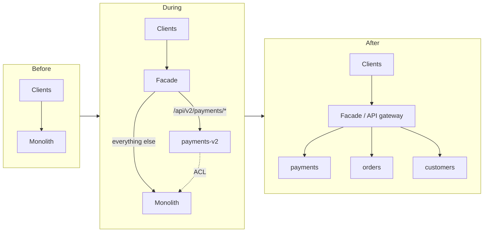

# Strangler Fig Pattern

The strangler fig replaces a legacy system **one slice at a time**. A facade sits in front of the legacy
system. New services take over individual capabilities behind it. The legacy system shrinks until it can
be switched off. This is how the portfolio's **Refactor** dispositions ([portfolio-7rs.md](./portfolio-7rs.md))
run without a big-bang rewrite. The reference implementation is
[deploy/k8s/strangler](../../deploy/k8s/strangler/README.md).

## Pattern

Three things make it work:

1. **One entry point** that you control: an API gateway (Kong in this repo), an ingress, or a service mesh.
2. **Slices with clear seams**: a URL prefix, a message topic, or a bounded context with its own data.
3. **Reversible routing**: every step can be undone by changing a weight or a header rule.

## Stages

| Stage | What changes | Exit criterion | Rollback |
|---|---|---|---|
| **1. Intercept** | DNS / LB moves to the facade, which still sends 100 % to legacy | Latency and errors through the facade equal the direct path for 24–72 h | DNS back to the legacy LB |
| **2. Route** | The route to the new service exists. Only opt-in traffic uses it (`x-strangler-route: v2`); optional shadow mirroring | Functional parity on canary traffic; shadow diffs explained | Remove the header route |
| **3. Migrate slice** | Weighted shift 5 → 25 → 50 → 100 %. Data ownership moves to the new service | SLOs met at 100 % for the observation period; legacy path for the slice idle | Lower the weight, or pin with `x-strangler-route: legacy` |
| **4. Retire legacy** | Repeat per slice. When the catch-all route is idle, freeze, archive and decommission the monolith | No traffic on the catch-all; data archived; licences returned | Restore from the archived VM (time-boxed) |

The walkthrough with commands is in [deploy/k8s/strangler/README.md](../../deploy/k8s/strangler/README.md).

## Routing

| Technique | How it is done here | Use it for |
|---|---|---|
| Path routing | Kong regex route `~/api/v2/payments(/|$)` | Defining the slice |
| Header canary | Kong route with `headers: {x-strangler-route: [v2]}`, which outranks path-only routes | Testers, synthetic checks, internal users |
| Weighted split | Kong upstream `payments-split` with weighted targets (v2 and legacy) | Progressive rollout |
| Pin to legacy | `x-strangler-route: legacy` | Excluding a client that hits an issue |
| Shadow / mirror | Istio `VirtualService` `mirror` + `mirrorPercentage` (`mesh-shadow.yaml`); Kong OSS has no mirroring plugin | Comparing behaviour under real load without serving v2 responses |
| Correlation | Kong `correlation-id` plugin (`X-Correlation-ID`) | Matching legacy vs v2 logs and responses |

Routing rules:

- **Non-idempotent endpoints** (payments) get `retries: 0` at the facade. Clients should send an
  `Idempotency-Key`.
- **Shadowing writes** is only safe when the new service suppresses side effects (no charge, no events,
  no emails) in shadow mode.
- **Sticky routing**: once a customer's data is owned by v2, that customer must always reach v2.
  Weighted splits are for stateless reads or for slices whose data is shared through sync. Otherwise,
  split by tenant/customer header rather than by random weight.

## Data synchronization

Moving data is the hard part. Pick one model per slice and write it down:

| Model | How | Watch out for |
|---|---|---|
| **Legacy remains system of record** (stages 1–2) | New service reads legacy data through the ACL or a CDC-fed read replica | Read-after-write lag on the replica |
| **CDC legacy → new** (stage 3 ramp) | DMS / Debezium streams the legacy tables into the new service's store ([database-migration.md](./database-migration.md)) | Schema translation in the ACL; ordering; backfills |
| **Ownership flip** | New service becomes the system of record; reverse CDC new → legacy keeps remaining legacy modules working | Write conflicts if both sides accept writes. Never run dual writers without a conflict rule |
| **Dual write** | App writes to both stores | Avoid it: no atomicity across stores. Use an outbox + CDC instead |

The flip is a cutover with its own go/no-go. Use the
[database cutover runbook](../../ops/runbooks/migration/database-cutover.md) for it.

## Anti-corruption layer (ACL)

The new service must not inherit the legacy model. The ACL is a small translation component, a module
inside the new service or a sidecar service. It:

- translates legacy DTOs, codes and IDs into the new domain model, and back
- hides legacy protocols (SOAP, EBCDIC copybooks, stored-procedure APIs) behind a clean interface
- holds the "which side owns this record" logic during the migration
- is deleted when the legacy dependency is gone. Track it as debt with an end date.

## When not to use it

- **Small systems** that a team can rewrite and cut over in one release. The facade costs more than it saves.
- **No interception point**: batch-file integrations, shared-database integrations, or thick clients
  talking straight to the DB. Fix the integration first, or use change-data-driven decomposition.
- **Tightly coupled data** where every slice needs every table. Slicing creates a distributed monolith.
  Do a data-model refactor, or rehost/replatform instead.
- **Retire or repurchase dispositions**. Nothing should be built on top of a system that is going away.
- **No budget for the long tail.** The last slices are the hardest. If the business will stop funding at
  70 %, you end up running both systems indefinitely. Get the exit criteria funded up front.
