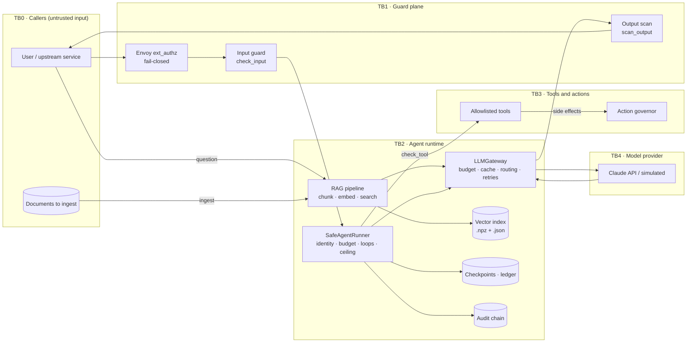

# AgentOps threat model: STRIDE × OWASP LLM Top 10 × MITRE ATLAS

| | |
|---|---|
| Scope | LLM gateway (`golden.agentops.llm.LLMGateway`), safe agent runner (`golden.agentops.runner`), RAG pipeline (`golden.ai.rag`), tool use, Envoy ext_authz guard, red-team and eval loops |
| Out of scope | Platform API, CI/CD, cloud IAM: see [platform-stride.md](./platform-stride.md) |
| Method | [docs/security/threat-modeling.md](../../docs/security/threat-modeling.md). Each threat gets a STRIDE category, an [OWASP Top 10 for LLM Applications (2025)](https://genai.owasp.org/llm-top-10/) ID and a [MITRE ATLAS](https://atlas.mitre.org/) technique |
| Review | On every model, system-prompt or tool change (the red-team gate runs then anyway), and quarterly |

## 1. Data-flow diagram

### Trust boundaries

| ID | Boundary | Why it matters |
|---|---|---|
| TB0→TB1 | Caller → guard | Prompts are attacker-controlled (direct injection, jailbreak, oversized input) |
| DOCS→IDX | Corpus → vector index | Ingested text is later placed in the prompt, which makes it an indirect-injection channel |
| TB2→TB4 | Runtime → model provider | Prompts and context leave the platform; responses come back untrusted |
| TB2→TB3 | Model decision → tool call | The model chooses actions, so this is where excessive agency turns into impact |

Rating follows the platform model: Likelihood × Impact, residual with inherent in brackets.

## 2. Threats

| ID | STRIDE | OWASP LLM | MITRE ATLAS | Threat | Mitigation | Evidence | Residual risk |
|---|---|---|---|---|---|---|---|
| AG-01 | Tampering / EoP | LLM01 Prompt Injection | AML.T0051.000 LLM Prompt Injection: Direct; AML.T0054 LLM Jailbreak | User prompt overrides instructions ("ignore previous…", role-play jailbreaks) | Input guard in code, not in the system prompt; also enforced at the proxy by Envoy ext_authz, fail-closed; continuous red-team probe suite gates canary → stable | `src/golden/agentops/guardrails.py`, `security/llm/envoy-ext-authz.yaml`, `src/golden/agentops/redteam.py`, `security/llm/redteam-workflow.yaml` | **Medium** [High]. The guard is heuristic, so new phrasings get through until a probe is added. A pluggable classifier (`classifier=`) can raise recall. |
| AG-02 | Tampering | LLM01 (indirect) · LLM08 Vector & Embedding Weaknesses | AML.T0051.001 LLM Prompt Injection: Indirect; AML.T0070 RAG Poisoning | Instructions planted in an ingested document reach the model as "context" | Retrieved passages are numbered and framed as context; the system prompt restricts answers to that context; outputs are evaluated for grounding and citation | `src/golden/ai/rag/pipeline.py`, `src/golden/agentops/evals.py` | **High** [High]. `RAGPipeline.ingest` doesn't run `check_input` on documents and doesn't record provenance. Action: guard ingested chunks and keep a source allowlist. |
| AG-03 | Information disclosure | LLM02 Sensitive Information Disclosure | AML.T0057 LLM Data Leakage | Model output leaks secrets, credentials or PII | Output scan redacts PII and *blocks* when a credential pattern is about to leave; the `no_secrets` eval runs on sampled traffic | `src/golden/agentops/guardrails.py`, `src/golden/agentops/evals.py` | **Medium** [High]. Pattern-based scanning misses secrets in unknown formats. |
| AG-04 | Information disclosure | LLM07 System Prompt Leakage | AML.T0056 LLM Meta Prompt Extraction | Attacker extracts the system prompt (and anything sensitive in it) | Extraction attempts blocked at input; the gateway checks responses with `leaks_system_prompt` (`protect_system_prompt=True`); no secrets in prompts by design | `src/golden/agentops/llm.py`, `src/golden/agentops/guardrails.py` | **Low** [Medium] |
| AG-05 | Elevation of privilege | LLM06 Excessive Agency | AML.T0053 LLM Plugin Compromise | Model calls a tool it should not have, or takes a high-impact action on its own | Per-agent identity with tool allowlist (unknown tools denied); side effects go through the action governor (allowlist, blast radius, caps, human approval for critical actions, kill switch) | `src/golden/agentops/runner.py`, `src/golden/agentops/agents.yaml`, `src/golden/security/actions.py` | **Medium** [High]. An `agents.yaml` entry that omits `allowed_tools` defaults to `["*"]` (`AgentIdentity`). Action: default to an empty list and lint the registry. |
| AG-06 | Tampering | LLM05 Improper Output Handling | AML.T0048 External Harms | Downstream code trusts model output (JSON, commands, URLs) | Property checks (valid JSON, required fields, length bounds) before output is used; tools receive structured steps, not free text | `src/golden/agentops/evals.py`, `src/golden/agentops/runner.py` | **Medium** [Medium]. Evals run on a *sample* in production, so per-call validation is up to each consumer. |
| AG-07 | Denial of service | LLM10 Unbounded Consumption | AML.T0029 Denial of AI Service; AML.T0034 Cost Harvesting | Prompt floods, loops or oversized prompts burn budget or capacity | Prompt size cap; per-caller daily token budget in the gateway; three-gate dollar budget (pre-flight, per-run, per-day persisted to disk); loop detection (stuck, bouncing, drifting); step ceiling; drain/kill; controls proven off→on in CI | `src/golden/agentops/llm.py`, `src/golden/agentops/budget.py`, `src/golden/agentops/loops.py`, `src/golden/agentops/proofs.py`, `observability/prometheus/rules/agentops_rules.yml` | **Low** [High]. The gateway's token budget is per process (see platform API-D1). |
| AG-08 | Spoofing | LLM06 | AML.T0053 | An unregistered agent or a caller impersonating an agent runs with someone else's budget and tools | `load_identity` refuses unknown agents; identity (name, team, owner) is in the ledger and audit trail | `src/golden/agentops/runner.py`, `src/golden/agentops/ledger.py` | **Medium** [Medium]. The agent name is supplied by the caller, not by a workload identity (SPIFFE / service account). |
| AG-09 | Repudiation | — | — | No record of what an agent did or why it stopped | Every run ends in a typed result (`success`, `looped`, `capped`, `killed`…) written to the append-only ledger and the hash-chained audit log | `src/golden/agentops/ledger.py`, `src/golden/security/audit.py` | **Low** [Medium] |
| AG-10 | Tampering | LLM03 Supply Chain · LLM04 Data & Model Poisoning | AML.T0010 AI Supply Chain Compromise; AML.T0018 Manipulate AI Model | Tampered model weights or a malicious checkpoint executes code on load | SHA-256 manifest verified before load; torch `weights_only=True`; signed images and SBOMs for serving containers | `src/golden/security/integrity.py`, `.github/workflows/containers.yml` | **Low** [High]. Hosted-model provenance is the provider's responsibility. |
| AG-11 | Tampering | — | — | Path injection through a task id writes checkpoints outside the state directory | Checkpoint file names are hashes of the task id, never caller input | `src/golden/agentops/checkpoint.py` | **Low** [Medium] |
| AG-12 | Information disclosure | LLM02 | AML.T0057 | The response cache returns one caller's answer to another | Cache key = prompt + system + model + max_tokens, so a hit needs an identical prompt | `src/golden/agentops/llm.py` | **Low** [Medium]. The cache is shared across callers. Don't enable it for prompts that embed caller-private data, or add the caller to the key. |
| AG-13 | — (integrity of answers) | LLM09 Misinformation | AML.T0048 External Harms | Confident, ungrounded answers are acted on | Grounding score and `cites_source` checks; a "not found" answer when retrieval falls below `min_score`; behavioural-drift baseline | `src/golden/ai/rag/pipeline.py`, `src/golden/agentops/evals.py` | **Medium** [Medium] |

## 3. Coverage check

| OWASP LLM Top 10 (2025) | Threats |
|---|---|
| LLM01 Prompt Injection | AG-01, AG-02 |
| LLM02 Sensitive Information Disclosure | AG-03, AG-12 |
| LLM03 Supply Chain | AG-10 |
| LLM04 Data and Model Poisoning | AG-02, AG-10 |
| LLM05 Improper Output Handling | AG-06 |
| LLM06 Excessive Agency | AG-05, AG-08 |
| LLM07 System Prompt Leakage | AG-04 |
| LLM08 Vector and Embedding Weaknesses | AG-02 |
| LLM09 Misinformation | AG-13 |
| LLM10 Unbounded Consumption | AG-07 |

## 4. Open actions

| Priority | Action | Closes |
|---|---|---|
| P1 | Run `check_input` on every chunk at `RAGPipeline.ingest`, record source provenance, allowlist corpora | AG-02 |
| P1 | Default `AgentIdentity.allowed_tools` to `[]` and lint `agents.yaml` for wildcards | AG-05 |
| P2 | Bind agent identity to the workload identity (Kubernetes service account / SPIFFE) | AG-08 |
| P2 | Add the caller to the gateway cache key, or make the cache opt-in per caller | AG-12 |
| P3 | Add indirect-injection probes (poisoned context) to the red-team suite | AG-02 |
