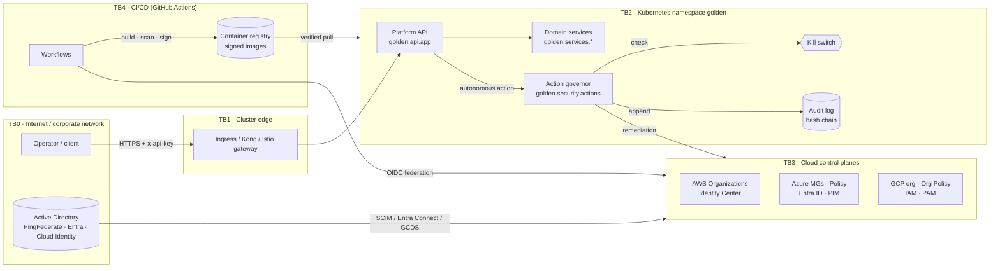

# Platform threat model — STRIDE

| | |
|---|---|
| Scope | Platform API and services, governed (autonomous) actions, audit chain, CI/CD supply chain, cloud IAM on AWS / Azure / GCP |
| Out of scope | LLM gateway, agent runner, RAG and tool use: see [agentops-stride.md](./agentops-stride.md) |
| Method | [docs/security/threat-modeling.md](../../docs/security/threat-modeling.md): DFD → trust boundaries → STRIDE per element → rating → mitigation with file evidence → residual risk |
| Review | Quarterly, and on any change that adds a trust boundary, an external integration or a new autonomous action |

Every mitigation below names the file that implements it, so a reviewer can open that file and check the
claim. A mitigation without evidence is listed as a gap under residual risk, not as a control.

## 1. Data-flow diagram

### Trust boundaries

| ID | Boundary | What crosses it | Who is on the far side |
|---|---|---|---|
| TB0→TB1 | Internet → cluster edge | Client HTTPS requests | Anonymous internet, partners, operators |
| TB1→TB2 | Edge → workload namespace | Authenticated API calls | Callers holding an API key |
| TB2→TB3 | Workload → cloud control plane | Remediation actions, read APIs | Cloud principals the platform assumes |
| IdP→TB3 | Directory → cloud identity | Users, groups, membership | AD admins, IdP admins |
| TB4→TB3 / TB4→TB2 | CI → cloud / cluster | Terraform plans, images, deploys | Contributors, third-party actions |

## 2. Rating

Likelihood (L/M/H) × Impact (L/M/H) → Risk: H×H, H×M, M×H = **High**; M×M, H×L, L×H = **Medium**; everything else = **Low**.
Ratings are for the threat *after* the listed mitigations (residual), with the inherent rating in brackets.

## 3. Threats

### 3.1 Platform API and services (TB0→TB2)

| ID | STRIDE | Threat | Mitigation | Evidence | Residual risk |
|---|---|---|---|---|---|
| API-S1 | Spoofing | Caller presents a guessed or leaked API key | Keys come from `GOLDEN_API_KEYS` (secret store), constant-time comparison; per-caller rate limit slows guessing | `src/golden/security/auth.py`, `src/golden/services/common.py`, `src/golden/security/ratelimit.py` | **Medium** [High]. API keys are shared secrets with no expiry; a leaked key works until it is rotated. Plan: OIDC / mTLS at the gateway. |
| API-T1 | Tampering | Malformed or out-of-range input drives a model to a harmful score | Input guardrails: finite, bounded, range-checked; scores clamped to [0, 1]; OOD flag stops automation | `src/golden/security/guardrails.py` | **Low** [Medium] |
| API-R1 | Repudiation | Operator denies approving a critical action | Critical actions need a named approver; approval is written to the hash-chained audit log | `src/golden/security/actions.py`, `src/golden/security/audit.py` | **Low** [Medium]. The approver name is asserted by the caller, not bound to an IdP identity (see API-S1). |
| API-I1 | Information disclosure | PHI/PII leaks through logs, audit entries or explanations | Redaction before logging and before hashing into the audit chain | `src/golden/security/redaction.py`, `src/golden/security/audit.py` | **Medium** [High]. Pattern-based redaction misses free-text identifiers it has no pattern for. |
| API-D1 | Denial of service | Request flood exhausts the API or a model | Token-bucket rate limit per caller; HPA + PDB in the chart | `src/golden/security/ratelimit.py`, `deploy/helm/golden/templates/hpa.yaml`, `deploy/helm/golden/templates/pdb.yaml` | **Medium** [High]. Limiter state is per process, so N replicas allow N× the limit. |
| API-E1 | Elevation of privilege | Compromised pod pivots inside the cluster | Non-root, read-only root filesystem, all capabilities dropped, seccomp RuntimeDefault; NetworkPolicy ingress allowlist (egress restriction opt-in via `networkPolicy.restrictEgress`); Kyverno admission (signed images, no `latest`) | `deploy/helm/golden/values.yaml`, `deploy/helm/golden/templates/networkpolicy.yaml`, `security/policies/kyverno/`, `security/policies/opa/k8s-security.rego` | **Low** [High]. Egress is open unless `restrictEgress` is set. |

### 3.2 Governed actions (TB2→TB3)

| ID | STRIDE | Threat | Mitigation | Evidence | Residual risk |
|---|---|---|---|---|---|
| GOV-T1 | Tampering | Caller invents an action the platform was never meant to take | Allowlist: only actions in `ACTION_CATALOG` exist; unknown actions are denied | `src/golden/security/actions.py` | **Low** [High] |
| GOV-D1 | DoS (self-inflicted) | A bad model or loop fires remediation at fleet scale | Blast-radius cap (`max_targets`), global and per-action hourly caps | `src/golden/security/actions.py` | **Low** [High] |
| GOV-E1 | Elevation of privilege | Autonomous mode runs a critical action without a human | Critical actions always need a named approver, in every autonomy mode | `src/golden/security/actions.py`, `tests/test_security.py` | **Low** [High] |
| GOV-E2 | Elevation of privilege | Operators cannot stop a runaway automation | Kill switch by env var or mounted file; the platform keeps detecting but executes nothing | `src/golden/security/killswitch.py`, `observability/prometheus/rules/ai_safety_rules.yml` | **Low** [High] |

### 3.3 Audit chain

| ID | STRIDE | Threat | Mitigation | Evidence | Residual risk |
|---|---|---|---|---|---|
| AUD-T1 | Tampering | An insider edits or deletes audit entries | Each entry carries the SHA-256 of its predecessor; `verify()` detects any edit or deletion | `src/golden/security/audit.py` | **Medium** [High]. A hash chain shows tampering, but it doesn't prevent truncation of the tail or a full rewrite by someone with write access. Plan: ship entries to WORM storage (S3 Object Lock / immutable blob / locked GCS bucket) and anchor the head hash externally. |
| AUD-R1 | Repudiation | No record that an action happened | Every governor verdict (executed, denied, pending) is appended | `src/golden/security/actions.py` | **Low** [Medium] |

### 3.4 CI/CD supply chain (TB4)

| ID | STRIDE | Threat | Mitigation | Evidence | Residual risk |
|---|---|---|---|---|---|
| CI-S1 | Spoofing | Long-lived cloud keys stolen from CI secrets | OIDC federation (`id-token: write`) to AWS, Azure and GCP; no static cloud keys | `.github/workflows/deploy.yml` | **Low** [High] |
| CI-T1 | Tampering | Malicious or vulnerable image reaches the cluster | Trivy scan with fail-on-critical, cosign keyless signing + SBOM attestation, Kyverno `verifyImages` at admission | `.github/workflows/containers.yml`, `security/policies/kyverno/verify-images.yaml` | **Low** [High] |
| CI-T2 | Tampering | Vulnerable dependency or committed secret | pip-audit, npm audit, gitleaks on the tree and on each change | `.github/workflows/security.yml` | **Medium** [Medium]. These checks find known CVEs and known secret formats only. |
| CI-E1 | Elevation of privilege | A Terraform change grants admin or removes guardrails | OPA plan gate on IAM changes; access-model linters (`golden iam model`, `golden.identity.multicloud`) | `security/policies/opa/aws-iam.rego`, `src/golden/identity/model.py`, `src/golden/identity/multicloud.py` | **Medium** [High]. The OPA gate covers AWS IAM. Azure and GCP changes are covered by the model linters, not by a plan-time policy. |

### 3.5 Cloud IAM (IdP→TB3, TB2→TB3)

| ID | STRIDE | Threat | Mitigation | Evidence | Residual risk |
|---|---|---|---|---|---|
| IAM-S1 | Spoofing | Phished workforce credential used against a cloud console | Federation only (no cloud-local users); MFA at the IdP / Conditional Access; groups are looked up, never created in the cloud | `security/identity/access-model.yaml`, `security/identity/azure-access-model.yaml`, `security/identity/gcp-access-model.yaml` | **Medium** [High]. How strong the MFA is depends on IdP policy, which these files don't enforce. |
| IAM-E1 | Elevation of privilege | Standing admin access is abused | Admin exists only in the break-glass persona: AWS 1h session; Azure PIM-eligible Owner with approval and 1h activation; GCP PAM entitlement with approval and 1h grant. The linters fail any privileged role on another persona | `src/golden/identity/model.py`, `src/golden/identity/multicloud.py`, `deploy/terraform/modules/azure/governance/identity.tf`, `deploy/terraform/modules/gcp/org-governance/identity.tf` | **Low** [High] |
| IAM-E2 | Elevation of privilege | Delegated role creation escalates past the guardrails | AWS permission boundary + `enforce-permission-boundary` SCP; GCP org IAM deny policy on custom roles / SA keys; Azure: only break-glass holds Owner / User Access Administrator | `deploy/terraform/modules/aws/permission-boundary/`, `deploy/terraform/modules/aws/org-guardrails/`, `deploy/terraform/modules/gcp/org-governance/identity.tf` | **Medium** [High]. Azure has no boundary-equivalent for delegated role assignment beyond ABAC conditions, which this platform doesn't model yet. |
| IAM-T1 | Tampering | Someone disables the security services or weakens a guardrail | SCP `protect-security-services`; Azure Policy at the root MG (child scopes can't remove it); GCP deny policy exempting only break-glass and the deployer | `deploy/terraform/modules/aws/org-guardrails/policies/scp/`, `deploy/terraform/modules/azure/governance/main.tf`, `deploy/terraform/modules/gcp/org-governance/identity.tf` | **Low** [High] |
| IAM-I1 | Information disclosure | Data stored in an unapproved region or exposed publicly | Region allowlist on all three clouds; Azure: no NIC public IPs and HTTPS-only storage; GCP: no VM external IPs, uniform bucket access, no Cloud SQL public IP; AWS RCP data perimeter | the three governance modules above | **Low** [High] |
| IAM-R1 | Repudiation | Admin activity can't be attributed | Every grant is to a named directory group; break-glass activations need a justification (PIM / PAM) | `deploy/terraform/modules/azure/governance/identity.tf`, `deploy/terraform/modules/gcp/org-governance/identity.tf` | **Low** [Medium] |

## 4. Open actions

| Priority | Action | Closes |
|---|---|---|
| P1 | Replace shared API keys with OIDC / mTLS at the gateway and bind approvals to the IdP identity | API-S1, API-R1 |
| P1 | Ship the audit chain to WORM storage and anchor the chain head externally | AUD-T1 |
| P2 | Move rate limiting to a shared store (Redis) or to the gateway | API-D1 |
| P2 | Add plan-time policy (OPA / Sentinel) for Azure and GCP IAM changes | CI-E1 |
| P3 | Model Azure ABAC conditions on delegated role assignment | IAM-E2 |
